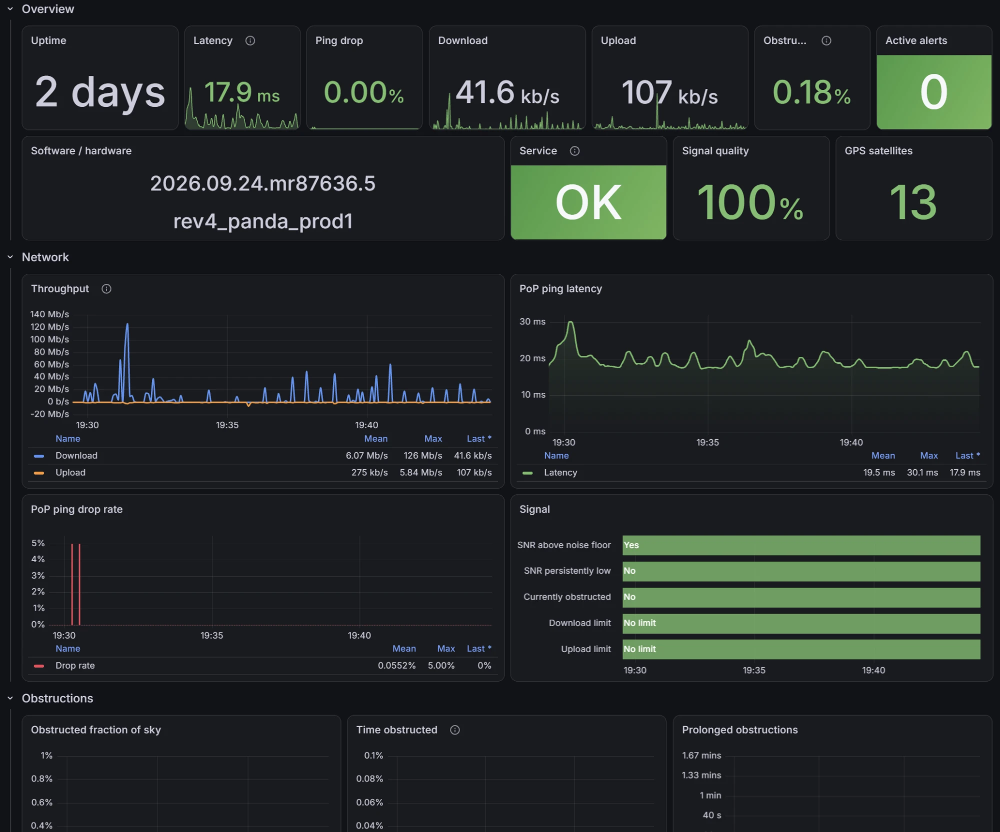

# Starlink Prometheus exporter

Polls the Starlink dish gRPC API (`SpaceX.API.Device.Device/Handle` at `192.168.100.1:9200`)
every 3 seconds and serves the data as Prometheus metrics at `http://<host>:9817/metrics`.



## How it works

On startup the exporter downloads the protobuf schema from the dish itself via gRPC server
reflection, encodes the request (`{"get_status": {}}`) and decodes the response using that
schema. As a result, new fields show up in the metrics automatically after a firmware update.

The fallback schema is the `.proto` files from [clarkzjw/starlink-grpc-golang](https://github.com/clarkzjw/starlink-grpc-golang/tree/master/proto)
in the `Protos/` folder (firmware 2026.09.24.mr87636.5; that repository is licensed under GPL-3.0).
They are compiled into the program and used when the dish responds but has reflection disabled
(`Unimplemented`), or when `SchemaSource=Embedded` is set. To update them, copy the latest files
from `proto/spacex_api` in that repository into `Protos/spacex_api` and rebuild.

How response fields are mapped to metrics:

| Protobuf field                 | Metric                                                         |
|--------------------------------|----------------------------------------------------------------|
| number / bool                  | `starlink_dish_status_<path>` (a missing proto3 field is 0)    |
| enum                           | numeric value, plus its name as a label of `..._info`          |
| string                         | labels of `<path>_info{...} 1`                                 |
| nested message                 | recursive, with prefix `<path>_<field>`                        |
| repeated                       | `index` label (skipped if longer than `MaxRepeatedElements`)   |
| deprecated, bytes              | not exported                                                   |

Exporter metrics: `starlink_up{request}`, `starlink_request_duration_seconds{request}`,
`starlink_last_poll_timestamp_seconds`.

Useful `get_status` metrics: `starlink_dish_status_pop_ping_latency_ms`,
`starlink_dish_status_pop_ping_drop_rate`, `starlink_dish_status_downlink_throughput_bps`,
`starlink_dish_status_uplink_throughput_bps`, `starlink_dish_status_obstruction_stats_fraction_obstructed`,
`starlink_dish_status_device_state_uptime_s`, `starlink_dish_status_alerts_*`,
`starlink_dish_status_device_info_info{software_version=...}`.

## Running

```bash
dotnet run -c Release
```

## Running on Linux as a systemd service

The exporter is published as a single self-contained executable, so the target machine does not
need .NET installed. It must be able to reach the dish at `192.168.100.1:9200` (usually true for
any host on the Starlink router's network).

### 1. Build

On a Linux machine, install the .NET 10 SDK (or use your distribution's `dotnet-sdk-10.0`
package, see [Install .NET on Linux](https://learn.microsoft.com/dotnet/core/install/linux)):

```bash
curl -sSL https://dot.net/v1/dotnet-install.sh | bash -s -- --channel 10.0
export PATH="$HOME/.dotnet:$PATH"
```

Then clone and publish:

```bash
git clone https://github.com/DBalashov/starlink-exporter.git
cd starlink-exporter
dotnet publish -c Release -r linux-x64 --self-contained -p:PublishSingleFile=true -o publish/linux
```

Use `-r linux-arm64` for a Raspberry Pi or another 64-bit ARM board. The same command also works
on Windows or macOS to cross-build for Linux; then copy `publish/linux` to the target machine.

`publish/linux` contains the `StarlinkExporter` executable and `appsettings.json`.

### 2. Install

```bash
sudo mkdir -p /opt/starlink-exporter
sudo cp -r publish/linux/* /opt/starlink-exporter/
sudo chmod +x /opt/starlink-exporter/StarlinkExporter
```

### 3. Create the service

```bash
sudo tee /etc/systemd/system/starlink-exporter.service > /dev/null <<'EOF'
[Unit]
Description=Starlink Prometheus exporter
After=network-online.target
Wants=network-online.target

[Service]
Type=simple
ExecStart=/opt/starlink-exporter/StarlinkExporter
# appsettings.json is looked up in the working directory
WorkingDirectory=/opt/starlink-exporter
DynamicUser=yes
Restart=always
RestartSec=5
# Overrides for appsettings.json, if needed:
#Environment=Starlink__Address=http://192.168.100.1:9200
#Environment=URLS=http://0.0.0.0:9817

[Install]
WantedBy=multi-user.target
EOF
```

`WorkingDirectory` is required: without it `appsettings.json` is not found and the defaults are
used. `DynamicUser=yes` runs the service as a transient unprivileged user, so no account has to
be created.

### 4. Start

```bash
sudo systemctl daemon-reload
sudo systemctl enable --now starlink-exporter
```

Check that it works:

```bash
systemctl status starlink-exporter
curl -s localhost:9817/metrics | grep starlink_up
journalctl -u starlink-exporter -f
```

If a firewall is enabled, open port 9817 for Prometheus (for example `sudo ufw allow 9817/tcp`).

### Updating

Pull the latest code, publish again, then:

```bash
sudo cp publish/linux/StarlinkExporter /opt/starlink-exporter/
sudo systemctl restart starlink-exporter
```

Copy `appsettings.json` too only if you have not changed it on the server.

## Configuration (`appsettings.json` or environment variables)

| Key                             | Default                      | Env                                    |
|---------------------------------|------------------------------|----------------------------------------|
| `Urls`                          | `http://0.0.0.0:9817`        | `URLS`                                 |
| `Starlink:Address`              | `http://192.168.100.1:9200`  | `Starlink__Address`                    |
| `Starlink:SchemaSource`         | `Auto`                       | `Starlink__SchemaSource`               |
| `Starlink:PollInterval`         | `00:00:03`                   | `Starlink__PollInterval`               |
| `Starlink:RequestTimeout`       | `00:00:02`                   | `Starlink__RequestTimeout`             |
| `Starlink:Requests`             | `["get_status"]`             | `Starlink__Requests__0`, `__1`, ...    |
| `Starlink:MaxRepeatedElements`  | `32`                         | `Starlink__MaxRepeatedElements`        |

`SchemaSource`: `Auto` uses reflection and falls back to the embedded protos if the dish does
not support it; `Reflection` uses reflection only; `Embedded` uses the embedded protos only (no
reflection calls).

`Requests` lists field names of the `SpaceX.API.Device.Request` message. Each request is exported
with the prefix `starlink_<response field without "get_">`. For example, `get_device_info`
produces `starlink_device_info_*`.

## Grafana

Dashboard: [grafana_dashboard.json](grafana_dashboard.json). To import: Dashboards → New → Import →
Upload JSON file. The data source is chosen with the `Data source` variable (by default the one
named `prometheus`), and the dish with the `Dish` variable (the `instance` label).

Sections: Overview (uptime, latency, throughput, obstructions, alerts, software and hardware
version, service status), Network, Obstructions, Alignment & GPS, Alerts & readiness,
Device & software. Collapsed sections: Power & hardware, All metrics (a table of all current
values) and Exporter.

## Prometheus

```yaml
scrape_configs:
  - job_name: starlink
    scrape_interval: 3s
    static_configs:
      - targets: ['localhost:9817']
```
